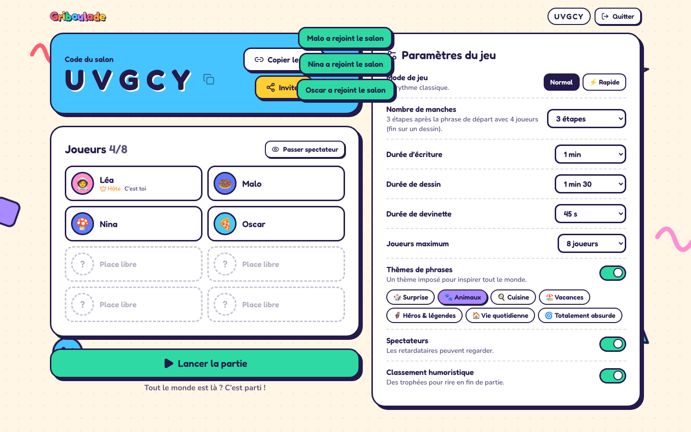
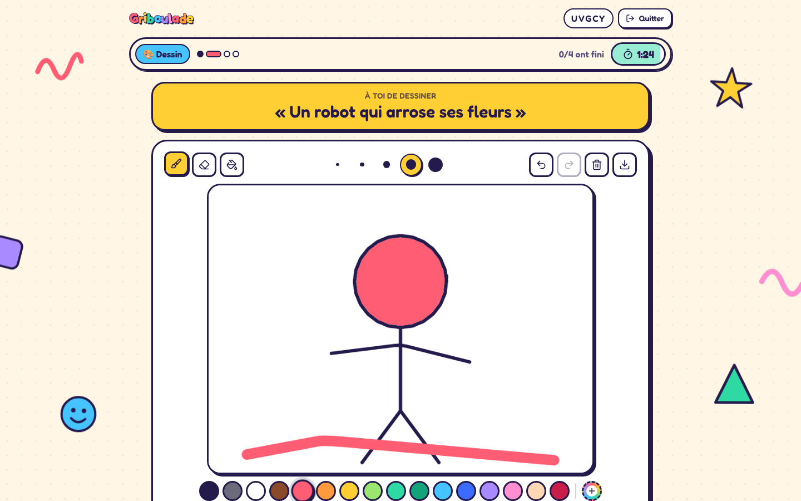
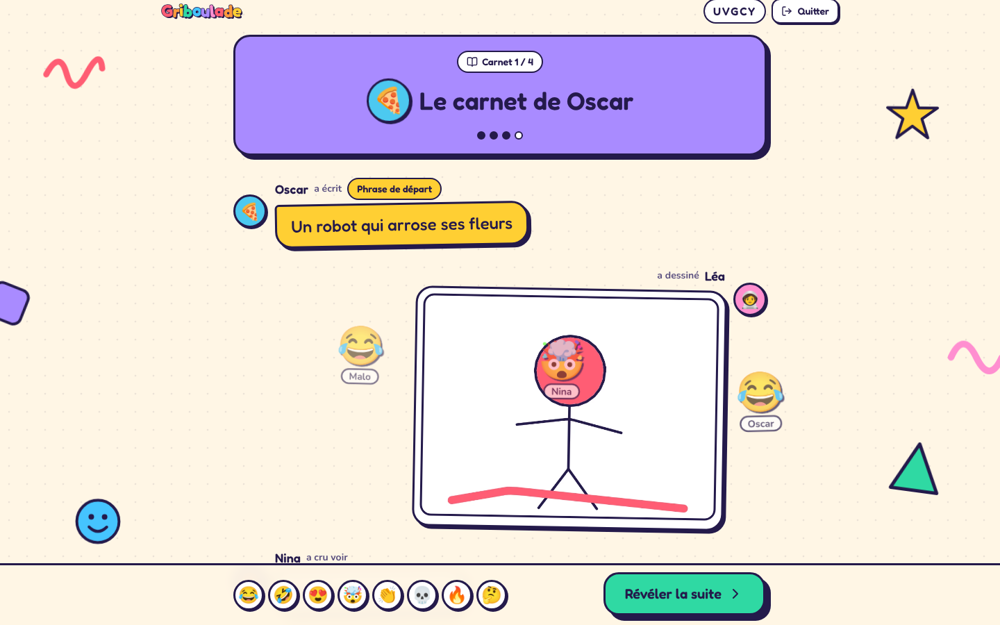

# Griboulade 🖍️

**Le téléphone arabe, mais avec des dessins.** Chacun écrit une phrase, un autre la dessine, un troisième
devine le dessin, un quatrième redessine… et à la fin, tout le monde découvre le désastre.

Jeu web multijoueur en temps réel, de 3 à 12 joueurs, gratuit et sans inscription.

- **Vrai multijoueur** : salons privés avec code, synchronisation Socket.IO, reconnexion automatique.
- **Éditeur de dessin complet** : pinceau, gomme, pot de peinture, 5 tailles, palette personnalisable,
  annuler / rétablir, téléchargement, sauvegarde automatique — à la souris, au doigt ou au stylet.
- **Révélation animée** pilotée par l'hôte, réactions emoji en direct, classement humoristique,
  statistiques, galerie partageable, historique des parties, mode spectateur.
- **Hébergeable gratuitement** : site statique (Cloudflare Pages / Vercel) + serveur Node (Render)
  + PostgreSQL (Neon). Voir **[docs/DEPLOIEMENT.md](docs/DEPLOIEMENT.md)**.

| Salle d'attente | Dessin | Révélation |
| --- | --- | --- |
|  |  |  |

## Démarrage rapide

Prérequis : [Node.js](https://nodejs.org) 20.19 ou plus récent (22 conseillé).

```bash
npm install
```

```bash
npm run dev
```

Ouvre ensuite <http://localhost:5173>. Pour simuler plusieurs joueurs, ouvre le lien d'invitation dans
des fenêtres de **navigation privée** (ou d'autres navigateurs) : chaque navigateur est un joueur.
Pour jouer avec un téléphone sur le même Wi-Fi, utilise l'adresse « Network » affichée par Vite.

Aucune base de données n'est nécessaire en développement : sans `DATABASE_URL`, tout est gardé en mémoire.

## Commandes

| Commande | Effet |
| --- | --- |
| `npm run dev` | Serveur de jeu (port 3001) + site (port 5173) avec rechargement à chaud |
| `npm run build` | Compile le serveur (`server/dist`) et le site (`client/dist`) |
| `npm start` | Lance le serveur compilé ; il sert aussi le site si `client/dist` existe |
| `npm test` | Tests du serveur : chaîne des carnets, partie complète, chrono, reconnexion, stockage |
| `npm run typecheck` | Vérification TypeScript du serveur et du client |
| `npm run e2e` | Partie complète jouée par 4 vrais navigateurs (nécessite Playwright) |

Le test PostgreSQL ne s'exécute que si `TEST_DATABASE_URL` pointe vers une base de test.

## Architecture

```
griboulade/
├── shared/src/          Types, constantes, règles (tours, thèmes) — importés par les deux côtés
├── server/src/
│   ├── index.ts         Démarrage, arrêt propre (sauvegarde des salons sur SIGTERM)
│   ├── app.ts           Express + Socket.IO, CORS, API HTTP, service du site (optionnel)
│   ├── socket.ts        Événements temps réel → appels à la logique de jeu
│   ├── config.ts        Variables d'environnement
│   ├── game/
│   │   ├── Room.ts          Un salon : membres, paramètres, tours, révélation, vues par joueur
│   │   ├── RoomManager.ts   Registre des salons : horloge, persistance, restauration, nettoyage
│   │   ├── chain.ts         Distribution des carnets (personne ne reçoit le sien)
│   │   ├── awards.ts        Statistiques et classement humoristique
│   │   └── util.ts          Codes de salon, nettoyage des textes, validation des images
│   └── store/           Persistance : mémoire (dev) ou PostgreSQL (prod), même interface
├── client/src/
│   ├── lib/             Connexion Socket.IO + état (Zustand), stockage local, configuration
│   ├── components/      Boutons, cartes, chrono, éditeur de dessin, carnets, résumé de partie
│   └── pages/           Accueil, création, rejoindre, salon (attente / jeu / révélation / fin),
│                        historique, galerie
├── scripts/e2e.cjs      Test de bout en bout multi-navigateurs
├── render.yaml          Déploiement du serveur sur Render
├── vercel.json          Déploiement du site sur Vercel (netlify.toml : solution de secours)
└── Dockerfile           Image « tout-en-un » pour n'importe quel hébergeur de conteneurs
```

### Principes

- **Le serveur fait autorité.** Les clients n'envoient que des intentions ; le serveur valide tout
  (rôle d'hôte, étape en cours, taille et format des images) et renvoie à chaque joueur une vue
  *personnalisée* de l'état : un client ne reçoit jamais une phrase ou un dessin qu'il n'a pas le droit
  de voir avant la révélation.
- **Chaîne des carnets.** Les joueurs sont placés dans un ordre aléatoire ; à chaque étape, chaque
  carnet avance d'un cran. Avec au plus `joueurs − 1` étapes, personne ne retombe sur son propre carnet
  ni deux fois sur le même (propriété vérifiée par les tests pour 3 à 12 joueurs).
- **Tours sans intervention.** Une étape se termine dès que tous les joueurs présents ont validé, ou à
  l'expiration du chrono. Les brouillons (texte et dessin) sont envoyés automatiquement : si le temps
  s'écoule, c'est le brouillon qui est utilisé. Un joueur déconnecté est attendu 20 secondes, puis la
  partie continue sans lui ; il peut revenir à tout moment.
- **Rien sur le disque du serveur.** Salons en cours, dessins (WebP, ~10–60 Ko) et parties terminées
  vont dans PostgreSQL. Après un redémarrage ou une mise en veille de l'hébergeur, les salons sont
  restaurés et les joueurs reprennent leur place.

### Variables d'environnement

| Fichier | Variable | Rôle |
| --- | --- | --- |
| `client/.env.example` | `VITE_SERVER_URL` | Adresse publique du serveur de jeu (vide en local) |
| `server/.env.example` | `PORT` | Port d'écoute (fourni par l'hébergeur en production) |
| | `NODE_ENV` | `production` en ligne |
| | `CLIENT_ORIGIN` | Adresse(s) du site autorisées (CORS + WebSocket), jokers acceptés |
| | `DATABASE_URL` | Base PostgreSQL ; vide = stockage en mémoire |
| | `DATABASE_SSL` | `require` (défaut), `verify` ou `disable` |
| | `GAME_RETENTION_DAYS` | Durée de conservation des parties (30 jours par défaut) |
| | `CLIENT_DIST` | Dossier du site à servir en mode « tout-en-un » |

## Mettre le jeu en ligne

Tout est expliqué pas à pas dans **[docs/DEPLOIEMENT.md](docs/DEPLOIEMENT.md)** : publication sur GitHub,
base Neon, serveur sur Render, site sur Cloudflare Pages ou Vercel, liaison des deux, dépannage et
solutions de secours.
